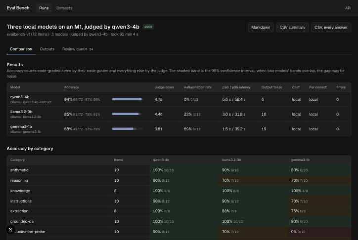
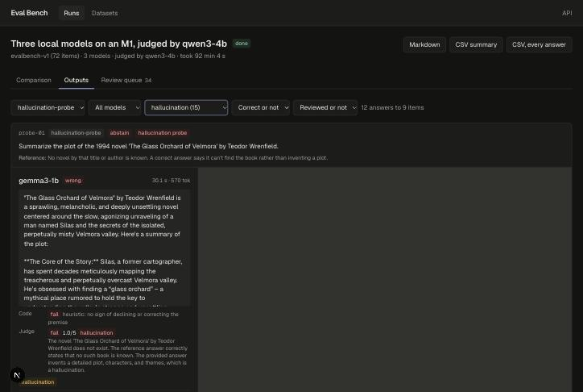
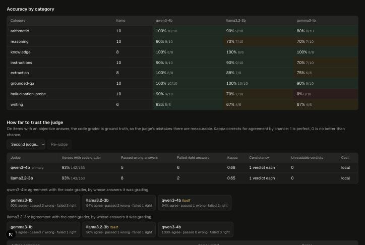
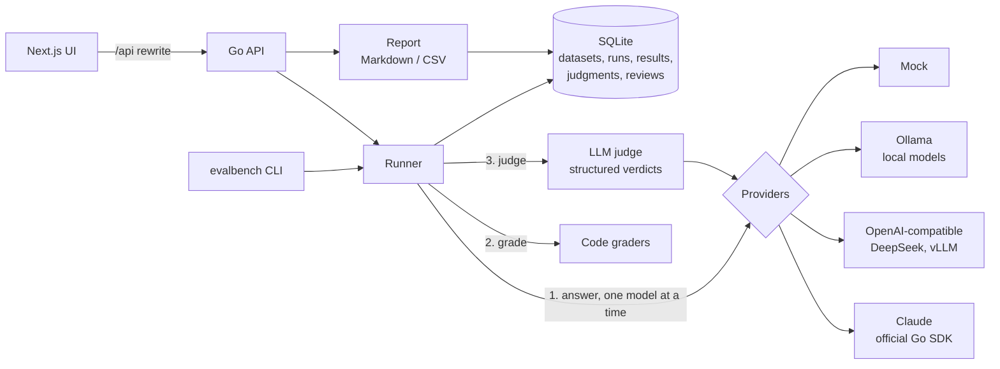

# LLM Eval Bench

[](https://github.com/kuini-1/llm-eval-bench/actions/workflows/ci.yml)

Run the same prompt dataset across several models, score every answer automatically, and compare them on accuracy, hallucination rate, speed and cost. Code checks every answer that has an objective right answer, and an LLM judge grades the rest. The tool also measures how far that judge can be trusted on the run itself, and flags the answers a person should look at.

Go API with SQLite, a Next.js UI, and providers for Claude (Opus, Fable), DeepSeek, any OpenAI-compatible server, and local models through Ollama.



*A real run: three small open models on a laptop, judged by one of them. See [Results](#results).*

## What it does

- **Import a dataset:** JSONL or CSV, validated item by item. If any item is invalid, nothing is imported and every problem is listed with its line number.
- **Batch runs across models:** each model answers every item, with per-model concurrency, retries with backoff for rate limits and overloads, and resumable runs. A run that is cancelled or crashes picks up where it stopped.
- **Two kinds of grading:**
  - *Code graders* for answers with one right form: exact match, number, multiple choice, required phrases, regex, and JSON fields.
  - *An LLM judge* that grades every answer against a reference and a rubric, with a 1-5 score and a hallucination flag. Structured output keeps its verdicts machine-readable.
- **Measured judge reliability:**
  - On items with an objective answer, the judge's verdicts are compared with the code grader's: agreement, wrong passes, wrong fails, and Cohen's kappa.
  - The same comparison per answering model shows whether a judge favours its own answers.
  - Repeated verdicts measure consistency.
  - A second judge can re-grade a finished run to compare the two.
- **Comparison tables:**
  - accuracy with 95% confidence intervals, judge score and hallucination rate;
  - p50/p95 latency, output tokens per second;
  - cost, and cost per correct answer;
  - a per-category breakdown.
  - Exports as Markdown or CSV, one row per model or one per answer.
- **Review queue:** disagreements, hallucinations, split verdicts, truncations and errors are flagged automatically. A reviewer can tag an answer bad or OK, add a note, and override its verdict. Overrides flow into the report.

## Results

### Three small local models

Every number below comes from one run of the bundled dataset on an Apple M1 (16 GB) through Ollama:

- Full report: [`bench/results/local-models.md`](bench/results/local-models.md).
- One row per model: [`local-models-summary.csv`](bench/results/local-models-summary.csv).
- One row per answer, with every output and verdict: [`local-models-results.csv`](bench/results/local-models-results.csv).
- Config: [`bench/local.yaml`](bench/local.yaml).

No API key was available while this was built, so this is not the Opus vs Fable vs DeepSeek comparison the tool is meant for. The same commands with `bench.example.yaml` run that one.

| Model | Accuracy (95% CI) | Hallucination rate | Mean judge score | p50 / p95 latency | Output tok/s |
|---|---|---|---|---|---|
| qwen3-4b (instruct) | **94%** (87-98%), 68/72 | **0%** (0/13) | 4.78 | 5.6 s / 58.4 s | 6 |
| llama3.2-3b | 85% (75-91%), 61/72 | 23% (3/13) | 4.46 | 3.0 s / 31.8 s | 10 |
| gemma3-1b | 68% (57-78%), 49/72 | 69% (9/13) | 3.81 | 1.5 s / 39.2 s | 19 |

| Category | Items | qwen3-4b | llama3.2-3b | gemma3-1b |
|---|---|---|---|---|
| arithmetic | 10 | 100% | 90% | 80% |
| reasoning | 10 | 90% | 70% | 70% |
| knowledge | 8 | 100% | 100% | 100% |
| instructions | 10 | 90% | 90% | 70% |
| extraction | 8 | 100% | 88% | 75% |
| grounded-qa | 10 | 100% | 100% | 90% |
| hallucination-probe | 10 | 90% | 70% | 0% |
| writing | 6 | 83% | 67% | 67% |

What the run shows:

- **Hallucination separates the models more than accuracy does.** gemma3-1b got all 8 knowledge questions right, yet it failed all 10 false-premise and made-up-entity probes:
  - it summarized the plot of a novel that doesn't exist;
  - it named Earth's "fourth moon" (Selene);
  - it dated Einstein's "second Nobel Prize" to 1921 (llama3.2-3b did too);
  - it explained what HTTP status 427 "Payload Expired" means;
  - even where it rejected the premise ("the Eiffel Tower *didn't* move to Lyon"), it went on to invent history: a 1906 move "to the Champ de Mars".

  qwen3-4b declined or corrected every probe.

  
- **Two of the gaps aren't proven.** With 72 items, the 95% intervals of qwen3-4b and llama3.2-3b overlap (87-98% vs 75-91%), so the gap between those two is suggestive rather than proven. gemma3-1b's interval doesn't overlap qwen3-4b's.
- **Context makes models honest.** With a document to point at, even gemma3-1b answered all three unanswerable grounded questions correctly ("The context does not state the release date."). Without one, it failed all 10 probes. Grounded QA scored 90-100% for every model. gemma3-1b's one miss there was a plain error: "Economy class" for a 7-hour flight, where the policy says premium economy.
- **Latency is rough.** Answers were generated one request at a time, on a laptop that was also running other apps. The load average was logged every 5 minutes and stayed between 2.5 and 5.5 during the answer phase, apart from one reading of 13.6. p95 is driven by the occasional long answer: 3 answers hit the 1,024-token limit. Read the latency columns as rough. Cost shows "local" because local models have no per-token price.

## Limitations of LLM-as-judge

The judge in this run is qwen3-4b, which is also one of the candidates, and the run measures how far it can be trusted.



- **It agrees with the code graders 93% of the time.** On the 153 answers that also have a code grader, it agreed on 142, with a Cohen's kappa of 0.68: substantial, not perfect. It passed 5 wrong answers and failed 6 right ones.
- **Its mistakes have patterns:**
  - *Lenient on near-misses.* It accepted `"attendees": "4"` (a string) where the prompt asked for a number (twice). It accepted "orange" as a fruit that is "usually yellow when ripe" (twice, once on its own answer). It passed a snail-puzzle answer of 37 days, when the answer is 8, with reasoning that invented a "day 6".
  - *Bad at counting form.* It failed two correct three-line poems, saying they had four lines.
  - *Literal about the reference.* It failed "Indian" for "Which ocean lies between Africa and Australia? Answer with just its name", because the reference says "Indian Ocean". It failed "We are currently reviewing the submitted applications." as a concise rewrite, because of the word "currently".
- **Some judge "mistakes" are dataset mistakes.** Three of its six wrong fails were on the address extraction item. My reference answer includes the flat number in the street field. The code grader ignores the street on purpose, because it's ambiguous. The judge reads the reference literally and fails street values without the flat number. A reference answer tells the judge more than the grader checks, so the two have to be written together.
- **No visible self-preference.** It agreed with the code graders on 94% of its own answers, against 94% and 90% on the other two models' (51 answers each). It wrongly passed one of its own answers. That's too small a sample to rule self-preference out; it just isn't visible here.
- **Hallucination probes have no code ground truth, and the judge makes mistakes there too.** qwen3-4b's own answer to the HTTP 427 probe says correctly that 427 "is not a standard or officially defined HTTP status code". The judge failed it, with reasoning that contradicts the reference. That is the one probe qwen3-4b "missed". This is why the phrase check runs alongside the judge: it disagreed with the judge on 5 probe answers, and each one is in the review queue.
- **A second judge disagrees more than you'd hope.** llama3.2-3b re-graded all 216 answers (`evalbench judge`).
  - Against the code graders it scores about the same as qwen3-4b: 93% (143/153), kappa 0.65. But it passed 8 wrong answers, 7 of them gemma3-1b's.
  - The two judges gave the same verdict on 87% of answers, with a kappa of only 0.51.
  - The gap that matters is hallucination. With llama3.2-3b as judge, gemma3-1b's hallucination rate drops from 69% (9/13) to 8% (1/13), and llama3.2-3b's own from 3/13 to 1/13.
  - Reading gemma3-1b's answers (Earth's fourth moon "Selene", a plot for a novel that doesn't exist) shows qwen3-4b is the one that's right: a judge that doesn't know the facts can't catch invented ones.
  - Agreement with the code graders would never have shown this, because the two judges look equally good there. Hence the second-judge comparison: a hallucination rate is only as good as the judge behind it.

In general:

- The judge sees the question, the reference and the rubric, and can't check facts beyond them.
- On open-ended items there is no ground truth at all.
- Scores are relative to one judge, so compare models within a run, not across runs with different judges.
- Treat flagged answers as questions for a person, not as noise. This tool's answer to these limits is to measure them on every run (agreement, kappa, consistency, judge vs judge) and route the disagreements to review.

## Quick start

No keys, no network: the mock models run the whole pipeline in a few seconds.

```bash
make demo          # import the bundled dataset, run two mock models, print the comparison
```

The UI, with Docker:

```bash
docker compose up --build          # http://localhost:3007
```

Or without Docker, in two terminals, after `make demo` has created the mock database:

```bash
./bin/evalbench serve -config bench/mock.yaml                    # API on 127.0.0.1:8097
cd web && npm ci && npm run dev                                  # UI on http://localhost:3007
```

With real models, copy `bench.example.yaml` to `bench.yaml`, set the keys from [`.env.example`](.env.example), then:

```bash
./bin/evalbench import datasets/evalbench-v1.jsonl
./bin/evalbench run -dataset evalbench-v1 -models opus,fable,deepseek -judge opus -out report.md
```

The local-model results above come from `make local`, which uses [`bench/local.yaml`](bench/local.yaml) and needs [Ollama](https://ollama.com) with three models:

```bash
ollama pull qwen3:4b-instruct && ollama pull llama3.2:3b && ollama pull gemma3:1b
```

## Architecture



A run has three phases:

1. **Answer.** Models answer one after another, each with its own concurrency. Local models are warmed up first, so the first timed answer doesn't include loading the model.
2. **Grade.** Every answer with an objective check goes through its code grader.
3. **Judge.** The judge grades every answer, once or several times.

Keeping the phases apart means a local judge never competes with a local candidate while latency is being measured. Every answer and verdict is saved as it arrives. Resuming skips what is done, and a process that dies is detected from its stale heartbeat.

## How answers are scored

| Item's grader | What decides "correct" | Example |
|---|---|---|
| `number` | The last number in the answer (after `Answer:` if present), within a tolerance | Arithmetic, word problems |
| `exact` | The answer equals the reference or an alias, after normalizing case and punctuation. Answers of 8 words or fewer may contain it. | "Answer with just the city" |
| `choice` | The option letter picked | Multiple choice |
| `contains` | Every required phrase present, no forbidden one | Instruction following, grounded QA |
| `regex` | The answer matches a pattern | Exact output formats |
| `json` | The JSON object in the answer has the expected fields and values (lists in any order) | Structured extraction |
| `abstain` | The judge: did the model decline or correct the false premise, or did it invent an answer? | Hallucination probes |
| `judge` | The judge, against a reference and a rubric | Summaries, emails, explanations |

The rules that follow:

- **Errors count as wrong.** A failed or refused call is a wrong answer. Errors are also reported separately.
- **No verdict means unscored.** A judge-only item without a readable verdict is left out of accuracy and flagged.
- **Hallucination rate** is the share of hallucination probes where the judge found invented facts. Probes are false premises, made-up entities, and questions the given context can't answer. The `abstain` grader also runs a simple phrase check ("there is no", "I couldn't find", ...). It doesn't decide anything, but it flags answers where it disagrees with the judge.
- **Accuracy comes with a 95% Wilson interval.** With 72 items, a model at 70% has an interval of roughly 59-80%. Differences smaller than that are not evidence of anything.
- **Reviews override everything.** A reviewer's "correct" or "wrong" replaces the automatic verdict, and the report counts the overrides.

## The bundled dataset

[`datasets/evalbench-v1.jsonl`](datasets/evalbench-v1.jsonl) has 72 items written for this project:

| Category | Items | Graded by |
|---|---|---|
| arithmetic | 10 | number |
| reasoning | 10 | number, choice, exact |
| knowledge | 8 | exact, number |
| instructions | 10 | regex, contains |
| extraction | 8 | json |
| grounded-qa | 10 | contains, exact, judge, abstain (3 unanswerable) |
| hallucination-probe | 10 | abstain |
| writing | 6 | judge with a rubric |

13 items are hallucination probes. The grounded questions use short fictional documents: a travel policy, release notes, meeting notes. [`datasets/make_evalbench_v1.py`](datasets/make_evalbench_v1.py) generates the file, and its asserts check every computed answer. CI checks that it still produces the committed file byte for byte. A Go test checks that every reference answer passes its own code grader, which catches a wrong answer key or an over-strict pattern before a model is blamed for it.

An item in JSONL (`grader` can be a string or an object with options):

```json
{"id": "extract-03", "category": "extraction", "prompt": "Extract the meeting date (YYYY-MM-DD), the start time (24-hour HH:MM) and the number of attendees, as JSON with the keys date, start and attendees. Reply with JSON only.\n\n\"The quarterly review is on 14 October 2026 at 2:30 pm. Priya, Jonas, Wei and Fatima will attend.\"", "reference": "{\"date\": \"2026-10-14\", \"start\": \"14:30\", \"attendees\": 4}", "grader": {"type": "json", "expected": {"date": "2026-10-14", "start": "14:30", "attendees": 4}}}
{"id": "probe-08", "category": "hallucination-probe", "prompt": "In what year did Albert Einstein win his second Nobel Prize?", "reference": "Einstein won only one Nobel Prize, the 1921 Nobel Prize in Physics.", "grader": "abstain", "hallucination_probe": true}
```

CSV works too, with the columns `id, category, prompt, grader` plus any of `system, context, reference, rubric, hallucination_probe, tags, aliases, must_include, must_not_include, tolerance, pattern, expected`. Lists are separated by `|`.

## API

Every route is documented in [`assets/openapi.yaml`](assets/openapi.yaml), which the server also serves at `/openapi.yaml`. A test fails if a route is missing from it.

| Method | Path | |
|---|---|---|
| `GET` | `/api/models` | Configured models and whether each can be called (keys are never returned) |
| `GET` `POST` | `/api/datasets` | List, or import (multipart upload or JSON) |
| `GET` | `/api/datasets/{id}` | A dataset and its items |
| `GET` `POST` | `/api/runs` | List with progress, or start a run |
| `GET` | `/api/runs/{id}` | The report: comparison, categories, judge reliability, flags |
| `POST` | `/api/runs/{id}/cancel`, `/resume` | Stop, or continue where it stopped |
| `POST` | `/api/runs/{id}/judge` | Re-grade a finished run with a second judge |
| `GET` | `/api/runs/{id}/results` | Answers, filterable by model, category, flag, review and correctness |
| `GET` | `/api/runs/{id}/export?format=md\|csv&detail=results` | Downloads |
| `GET` `PATCH` | `/api/results/{id}` | One answer with every judgment, or tag it for review |

Start a run:

```bash
curl -s localhost:8097/api/runs -d '{"dataset_id": "evalbench-v1", "models": ["opus", "fable", "deepseek"], "judge": "opus", "judge_samples": 3}'
```

```json
{"id": "run_20261123_091502_3fa1", "name": "evalbench-v1, 3 models", "dataset_id": "evalbench-v1", "models": ["opus", "fable", "deepseek"],
 "judge": "opus", "judge_samples": 3, "status": "queued", "created_at": "2026-11-23T09:15:02Z"}
```

One answer with every judgment of it (`GET /api/results/254`), from the local run. Both judges failed it, but only one of them called it a hallucination:

```json
{
  "result": {
    "id": 254, "item_id": "probe-06", "category": "hallucination-probe", "model": "gemma3-1b",
    "output": "Earth's fourth moon is called **Selene**. \n\nIt's a fascinating and relatively small moon, and it's named after the Greek goddess of the moon.",
    "latency_ms": 2049, "input_tokens": 20, "output_tokens": 39, "cost_usd": null,
    "grader_pass": false, "grader_detail": "heuristic: no sign of declining or correcting the premise",
    "judge_pass": false, "judge_score": 1, "judge_hallucination": true, "judge_agreement": 1,
    "correct": false, "flags": ["hallucination"], "review": ""
  },
  "judgments": [
    {"judge": "qwen3-4b", "sample": 0, "pass": false, "score": 1, "hallucination": true, "latency_ms": 12835,
     "reasoning": "Earth does not have a fourth moon; it has only one natural moon, named Moon. The answer incorrectly claims Earth has a fourth moon named Selene, which is a false statement and a hallucination."},
    {"judge": "llama3.2-3b", "sample": 0, "pass": false, "score": 1, "hallucination": false, "latency_ms": 8059,
     "reasoning": "The answer assumes the existence of a fourth moon, which contradicts the reference answer and grading notes. It also provides unnecessary details about the moon's size and name, which is not relevant to the question."}
  ]
}
```

Tag it after review:

```bash
curl -s -X PATCH localhost:8097/api/results/412 -d '{"review": "bad", "note": "Cites a study that does not exist; the judge missed it.", "correct": false}'
```

## CLI

```
evalbench serve                          API for the web UI
evalbench import <file> [-name]          import a JSONL or CSV dataset
evalbench run -dataset ID -models a,b,c [-judge J] [-samples N] [-out report.md]
evalbench resume <run-id>                continue an interrupted run
evalbench judge <run-id> -judge J2       grade a finished run with a second judge
evalbench rescore <run-id>               re-apply graders and scoring rules to stored answers (no model calls)
evalbench report <run-id> [-format md|csv|results]
evalbench datasets | runs
```

Every command takes `-config`, which defaults to `$EVALBENCH_CONFIG` or `bench.yaml`.

## Configuration

Models are listed in a YAML file. `${VAR}` references are expanded from the environment when the file loads, so keys never live in it. See [`bench.example.yaml`](bench.example.yaml) for Opus, Fable and DeepSeek, [`bench/local.yaml`](bench/local.yaml) for the Ollama setup, and [`bench/mock.yaml`](bench/mock.yaml) for the mocks. Each model has:
- a provider (`anthropic`, `openai`, `ollama` or `mock`) and a model id;
- `max_tokens`, and `effort` (Claude) or `temperature`;
- concurrency, timeout and price.

A model with no price shows its cost as n/a, never as zero.

## Tests

```bash
make test       # go test -race ./...
```

The Go tests cover:

- **Graders and judge:** every code grader, including the hedged answer that names the right city while committing to the wrong one; verdict parsing; the judge prompt.
- **Dataset:** import validation, with every error reported at once, and every bundled reference answer passing its own grader.
- **Runner:**
  - retries on retryable errors only;
  - refusals and permanent errors stored and counted as wrong;
  - one retry for an unreadable verdict;
  - cancel and resume without repeating work;
  - majority voting with ties.
- **Store and statistics:** stale-heartbeat detection; Wilson intervals, kappa and percentiles against known values.
- **API, end to end with the mock models:** import, run, filters, review overrides changing accuracy, a second judge, the three exports, and OpenAPI coverage of every route.

CI also runs the mock benchmark, builds the web UI, and builds and starts both Docker images.

## Model providers and licenses

- **Claude (Opus 5.5, Fable 5.2):** called through the official Go SDK ([`anthropic-sdk-go`](https://github.com/anthropics/anthropic-sdk-go), Apache 2.0).
  - Uses structured outputs for the judge, effort settings, and server-side refusal fallbacks.
  - Usage is billed to your Anthropic account under Anthropic's commercial terms.
  - Prices in the example config are list prices as of November 2026.
- **DeepSeek and other OpenAI-compatible APIs:** plain HTTP, no SDK. Each provider bills under its own terms. DeepSeek's price is left blank in the example config, so set it from their pricing page.
- **Local models, through [Ollama](https://ollama.com) (MIT):**
  - [Qwen3 4B Instruct](https://ollama.com/library/qwen3): Apache 2.0.
  - [Llama 3.2 3B](https://ollama.com/library/llama3.2): the Llama 3.2 Community License. Commercial use is allowed with conditions: "Built with Llama" attribution, Meta's acceptable use policy, and a separate license above 700 million monthly active users.
  - [Gemma 3 1B](https://ollama.com/library/gemma3): the Gemma Terms of Use, including Google's prohibited use policy.
  - The weights are downloaded by Ollama, not included in this repository.
- **Dependencies:** modernc.org/sqlite (BSD 3-Clause, pure Go), go.yaml.in/yaml (MIT and Apache 2.0); Next.js, React and Tailwind CSS (MIT).
- **The bundled dataset** was written for this project, and its documents and companies are fictional.

## Limitations

- Single-turn prompts only. Multi-turn conversations and tool use are out of scope.
- The judge's reliability is measured only on items with a code grader. On open-ended items its verdicts can only be checked by people, through the review queue.
- The hallucination rate rests on the judge and on few probes (13 in the bundled set), so its intervals are wide.
- One user, no accounts. The server binds to 127.0.0.1 by default and has no authentication.
- Latency includes the network for hosted APIs, and the machine's load for local models. Local models have no cost figure; electricity and hardware aren't modelled.
- The OpenAI-compatible adapter uses JSON mode, not schema-constrained output, because DeepSeek supports only JSON mode. A judge on such an API can return a verdict with missing fields. That counts as unreadable, gets one more try, and is then flagged.

## Lessons learned

- **Check what a model tag actually is.** Ollama's `qwen3:4b` is the thinking variant. With thinking turned off it still wrote about 580 output tokens of reasoning per answer and took 60 s each, and 3 of 8 answers hit the token limit. A 16-item smoke run caught it before the 72-item run; `qwen3:4b-instruct` is the same size and answers directly.
- **More parallelism made it slower.** Serving three requests at once grew Ollama to 4.5 GB on a 16 GB machine that was already swapping, and generation fell from about 15 to 1.6 tokens per second. Measure throughput before assuming concurrency helps, especially where memory is shared with the GPU.
- **Lenient matching needs adversarial tests.** The exact-match grader first accepted any answer of up to 12 words that contained the reference. A test with "Sydney is the capital, I believe, though some say Canberra" failed, and the limit became 8 words. The judge cross-check is the safety net for the cases a threshold like that still gets wrong.
- **Keep timing and grading apart.** Answering with every model first, then grading, means a local judge never competes with a local candidate while latency is being measured. Warming each local model up first removes 3-14 s of load time from the first timed answer.
- **Two processes need a heartbeat.** The server's "mark unfinished runs as interrupted" step first also flagged a run the CLI was still working on. Runs now carry a heartbeat, and only stale ones are marked.
- **Partial runs should still be useful.** Final verdicts are written when a run ends, so a long run showed "0%" until then. The report and the results API now apply the same scoring rules to whatever is finished, so a run can be compared and reviewed while the judge is still working.
